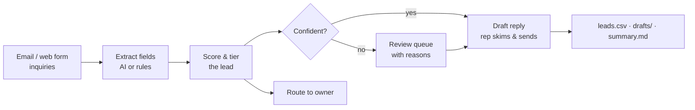

# AI-Assisted Customer Intake Automation

**Turning messy inbound inquiries into prioritized, routed, ready-to-send leads, with a human kept in the loop.**

A property services company gets inquiries from email and its website form. Every one of them used to be read, retyped into a spreadsheet, sized up, handed to someone, and answered by hand. This project automates that intake process and documents it the way an AI implementation would actually be run: baseline, build, measure, guardrails, rollout.

> Inspired by intake automation I built for property manager inquiries in a previous role. All company names, people, and contact details in this repo are fictional.

---

## Results on the sample inbox (15 real-world-style inquiries)

| Metric | Result |
|---|---|
| Field extraction accuracy (offline rules engine) | **~96%** across 7 fields, measured against hand-labeled answers |
| Inquiries ready to send after a quick skim | **9 of 15** |
| Inquiries flagged for a human, with the reason | **6 of 15** |
| Estimated staff time | **180 min → 27 min (~85% less)** |
| Highest-value leads | Automatically surfaced to the top and routed to a senior account manager |

Full numbers: [`output/summary.md`](output/summary.md) · [`output/accuracy.md`](output/accuracy.md) · Case study: [`docs/case_study.md`](docs/case_study.md)

---

## How it works



1. **Extract.** Pulls out name, company, email, phone, property type, unit count, services wanted, and urgency from free-text messages.
   - With an `ANTHROPIC_API_KEY` set, it uses Claude and asks for strict JSON.
   - Without one, it uses a rules engine (regex + keywords) that runs offline at no cost.
   - If the AI call fails, it falls back to the rules engine and flags the record, so intake never stops because a vendor is down.
2. **Score and route.** Plain, readable weights (portfolio size, property type, urgency, services bundled) produce a 0–100 score and a tier: *enterprise → Senior Account Manager*, *standard → Sales Rep Queue*, *small → Inside Sales*.
3. **Flag for review.** Missing contact info, unclear requests, and every high-value lead go to a human review queue with the specific reason.
4. **Draft the reply.** Approved templates, personalized with the customer's name, services, unit count and urgency. **Nothing is sent automatically.**
5. **Report.** A prioritized lead sheet, a review queue, one draft per inquiry, and a run summary with time saved.

## Quick start

```bash
git clone <this repo>
cd intake-automation
python run.py --eval            # offline, no install needed (Python 3.10+)
```

Optional AI engine:

```bash
pip install -r requirements.txt
export ANTHROPIC_API_KEY=your_key_here
python run.py --eval            # same pipeline, Claude does the extraction
```

Run the tests:

```bash
python -m unittest discover tests
```

Use your own inbox: `python run.py --input my_inquiries.json --out results/` (same format as [`sample_data/inquiries.json`](sample_data/inquiries.json)).

## Project structure

```
intake/
  extractor.py   AI + rules extraction, with automatic fallback
  scoring.py     lead score, tier, routing, and human-review flags
  responder.py   approved reply templates
  pipeline.py    end-to-end run and reports
  evaluate.py    accuracy against hand-labeled answers
sample_data/     15 messy sample inquiries + labeled answers
output/          results from the latest run
docs/
  case_study.md     the business problem, before/after, results
  rollout_plan.md   how I'd roll this out to a real team
tests/           unit and regression tests
```

## Design decisions

- **Human in the loop by default.** The system drafts; people send. High-value leads always get a human touch.
- **It says when it isn't sure.** Every flagged record carries a reason (`no_contact_info`, `service_unclear`, ...) so reviewers know what to check.
- **Measured, not assumed.** Accuracy is scored against labeled data, and a regression test fails if a change drops it below 90%.
- **Business-readable rules.** Scoring weights and routing live in one short file a sales manager can review.
- **No vendor lock-in.** The AI engine is optional and swappable; the offline engine keeps the process running.

## What I'd add next

- Connect directly to a shared inbox and CRM (HubSpot) instead of JSON/CSV files
- Compare AI vs. rules accuracy on a larger labeled set before choosing a default engine
- Track response time and lead-to-customer conversion after go-live to tune the scoring weights

---

Built by **Gavin Palm**, focused on AI implementation and business process automation.
